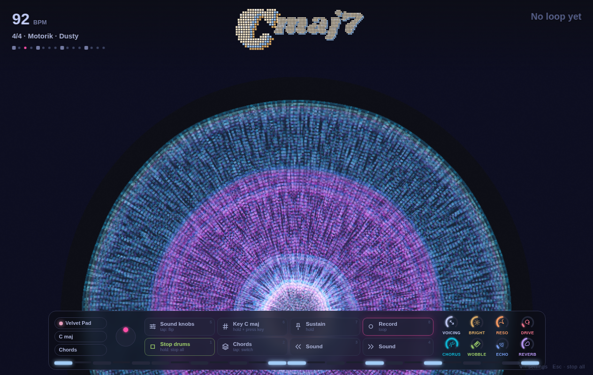

# daisy

A warm little chord synth for the Akai MPK Mini Mk II. One key plays a whole
chord and the joystick colours it, with built-in drums, a looper and a light show.

Named after "Daisy Bell", the first song a computer ever sang (1961).


```bash
tools/daisy.sh
```

Needs Chrome, Chromium or Edge (for Web MIDI) and Python 3. An MPK Mini Mk II is the intended
controller, but any MIDI keyboard or the computer keys will play it. The launcher and the MPK
setup script are Linux-only for now; elsewhere run `python3 tools/serve.py` and open
http://localhost:5173.

**Jam with Claude:** make a loop, then say *solo* to Claude Code in this folder. Claude reads your
chords through daisy's local server, writes a solo (or a duet, or one in 6/4 that drifts over
your 4/4) and daisy plays it back over the loop, bending the visuals into flowers as it goes.

Plain HTML, JavaScript and Web Audio. No build step, no dependencies. Controls and setup are in
[the guide](docs/GUIDE.md).

 
